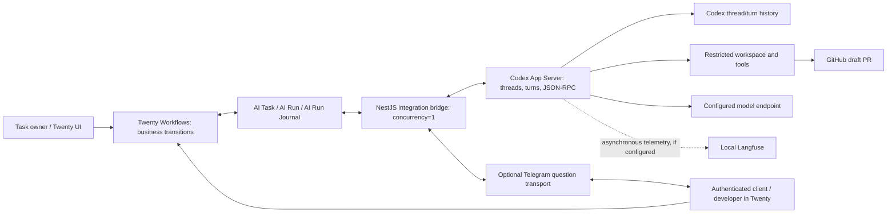

# PRD: Twenty + Codex App Server orchestrator

Language: English · Version: 0.5 · Date: 1 November 2026 · Status: selected NestJS worker + Codex App Server design; runtime Not verified.

[Русская версия](PRD.ru.md) · [Requirements](requirements.md) · [Pilot acceptance](requirements/acceptance.md)

## 1. Purpose and design basis

The product lets a task owner delegate engineering work to a selected specialist profile, follow execution in Twenty, resolve questions with a client or developer, and accept a result backed by mandatory checks and a draft PR. A NestJS worker controls Codex App Server through its version-pinned JSON-RPC interface. Twenty provides business records, queue authorization, and human decisions.

The [requirements register](requirements.md) and linked contracts are the project specification. Codex App Server is the selected target runtime; its integration behavior and all pilot criteria remain unverified until tested against a pinned Codex version. Existing REQ, DATA, STATE, PROTO, OPS, and all 28 SAI identifiers are preserved.

## 2. Users and outcomes

- Task owner / operator: submits work, monitors progress, assigns question recipients, authorizes permitted actions, requests cancellation or rework, and accepts the result in Twenty.
- Client employee: signs in with an individual Twenty account, sees the Kanban board and task details for their own client, and answers business questions addressed to them. They cannot see another client’s records or approve developer actions.
- Developer: answers technical questions and approves or rejects addressed tool actions within the developer's granted authority.
- Administrator: configures the local stack, project/repository policies, model access, identities, credentials, backups, and retention.
- Specialist profiles: perform scoped work sequentially in a run. The worker owns profile selection and handoff; Codex App Server provides threads, turns, and streamed events, not a persistent team/task ledger.

A question recipient and the task owner are separate responsibilities. Answering a question does not grant permission to accept the entire task, retry AI execution, merge, release, or deploy.

## 3. Goals and pilot scope

- Complete Project → task → authorized run → specialist work → checks → draft PR → human acceptance in the local Docker environment.
- Use Codex App Server threads, turns, and streamed events for execution while keeping product lifecycle and durable audit authority in Twenty.
- Keep Twenty workflows short: validate actions and facts, authorize queue/assignment operations, and apply business transitions.
- Show the client’s own tasks in Twenty Kanban and let authorized client employees answer addressed business questions there.
- Recover waiting and interrupted work without duplicate model execution, tool effects, PRs, or human decisions.
- Preserve one host, one execution worker, one Twenty workspace, one active run, and sequential specialists with `concurrency=1`.

The pilot includes rework, cancellation, an active-time budget, recovery, durable audit, and asynchronous Langfuse analytics. Metrics for this pilot include: first-run acceptance, check pass rate, questions and attempts, active/waiting time, rework reasons, and cost completeness. Numerical quality targets follow a measured baseline.

Outside this pilot are parallel agent execution, multiple hosts/workspaces, a separate client portal, auto-acceptance, automatic AI retry, merge, release, and deployment. Specialist profiles execute sequentially in one authorized run. Profile handoff is worker policy, not product acceptance or a lifecycle transition in Twenty.

## 4. Architecture and state ownership



- Twenty owns `Project`, `AiTask`, `AiRun`, business status, queue eligibility, authorization versions, review decisions, and durable command/event exchange in `AiRunJournal`.
- Codex App Server exposes threads, turns, items, and notifications. Its local rollout/history state is execution context, not the business command ledger or an exactly-once guarantee.
- NestJS translates and validates commands/events, enforces identity and policy boundaries, correlates external replies, and reconciles the two stores. It contains no second business workflow engine.
- Git/worktree artifacts and GitHub confirm file/PR effects. A tool response alone does not prove publication when delivery is uncertain.
- Langfuse stores diagnostics and analytics. It does not replace Journal or authorize execution.

The worker uses Twenty's supported workspace APIs with scoped credentials, pagination, and timeouts. It does not read or write Twenty PostgreSQL tables directly. Codex thread history and rollout files are retained/backed up separately from Twenty, but never replace `AiRunJournal`.

## 5. Codex App Server capabilities and integration boundary

| Capability | Target use | Integration boundary |
| --- | --- | --- |
| Threads and turns | Start/resume threads, start turns, and correlate notifications to the task/run | Persist `threadId` and `turnId` in Journal; thread history is not business state and does not prove a command ran exactly once |
| Bidirectional JSON-RPC | Worker sends requests and reads responses/notifications over stdio or a local Unix socket | Pin the Codex version and generated schema; remote WebSocket mode is experimental and excluded from the pilot |
| Streaming events | Observe agent messages, tool progress, and turn completion | Translate supported, version-pinned events into Journal facts; notification loss requires reconciliation |
| Approval and interruption | App Server supports approval interactions and `turn/interrupt` | Human decisions remain in Twenty; map approvals to the exact action and verify the runtime outcome |
| Workspace and permissions | Start threads with a working directory and sandbox/approval policy | Restrict workspace and credentials; validate policy enforcement on the pinned host configuration |
| Specialist profiles | Worker selects a validated instruction/model/policy profile for each sequential assignment | The proposed worker will implement and audit profile handoff; no persistent team/task ledger is assumed |
| Telemetry | Worker may export sanitized facts asynchronously to Langfuse | Analytics cannot block work or replace Journal; token/cost availability must be verified |

The worker launches a local `codex app-server` process and implements the JSON-RPC client. The documented stdio transport is the default; the WebSocket listener is experimental and unsupported for production workloads, so the pilot uses local stdio (or a local Unix socket only after validation). App Server supports `thread/start`, `thread/resume`, `turn/start`, streamed notifications, and `turn/interrupt`; these protocol operations do not provide Twenty command idempotency. Persist intent before each execution-changing call and reconcile after a lost response. Demonstrate the exact approval interaction and cancellation behavior on the pinned Codex build.

No default retry may replay an unknown operation or exceed the shared budget. Codex notifications are not a substitute for the Twenty dispatch queue. Model/provider support, tool availability, sandbox behavior, and cost reporting must be demonstrated for the pinned Codex configuration. Codex review or completion does not replace mandatory repository checks or human acceptance in Twenty.

## 6. Main user journey

1. The owner creates a task in Twenty with Project, description, acceptance criteria, and responsible people. Project defines the allowed repository, base branch, specialists, model policy, and mandatory checks.
2. “Submit” authorizes the task once and queues it as `READY`. Editing or autosaving a field does not start work.
3. Dispatch checks availability, project policy, and input completeness, then persists the immutable snapshot, run identity, and `START` intent. Pre-start clarification remains distinguishable from a question during an active run.
4. The NestJS worker starts or resumes the authorized Codex thread, persists its identity, starts the turn, and translates confirmed App Server events into Journal facts. A Workflow applies `RUNNING` only after confirmation.
5. The worker executes the selected specialist profile sequentially in the same task/run/worktree. A handoff is a worker-controlled next assignment after the prior turn and tools are confirmed complete; it retains task, run, worktree, snapshot, and budget.
6. When Codex requests tool approval or the worker identifies missing business input, the worker records the exact question/action and recipient in Journal; a Workflow applies `WAITING/INPUT` or `WAITING/APPROVAL`. The compatibility check must prove how an App Server approval request is held and answered through the bridge.
7. The client or developer answers in Twenty or, when enabled, through the bound Telegram identity. The bridge validates recipient, scope, question, assignment, and action version, records one answer in Journal, and responds through a supported approval/continuation path on the same thread. If no active request can be resumed safely, remain in RECOVERY instead of starting a replacement turn automatically.
8. Mandatory checks run in the restricted workspace. A successful attempt requires recorded check evidence and a draft PR in the expected repository/base/head.
9. The owner reviews the report and PR in Twenty. `ACCEPT` moves the task to `DONE`; `REWORK` creates a newly authorized engineering attempt with the previous result retained.

A confirmed check/execution failure requires a human retry decision. PR publication failure retries publication only after authorization and reconciliation. Cancelling an active run is complete only after execution and tools are proven stopped.

## 7. Questions for the client and developer

A logical question contains the text and safe context, `questionId`, task/run identity when present, `requestVersion`, `assignmentVersion`, INPUT/APPROVAL kind, intended recipient identity/role, channel, and current resolution. Runtime correlation uses Codex `threadId`, `turnId`, and JSON-RPC request id when available. These are proposed payload/schema mappings, not claims that all fields already exist in the installed Twenty App.

- Route business ambiguity to the assigned client and technical ambiguity to the assigned developer. Use verified project contacts; the model may suggest a role but cannot choose an account or grant authority.
- Ask one actionable question with required answer format or explicit allow/deny options. Show a safe action summary and exact action parameters for tool approval.
- Bind approval to the reviewed action, parameters, run, tool call, and policy version. A changed action requires a new approval; refusal is never converted into permission.
- Keep question text, recipient, answer/decision, actor, channel, and timestamps in the retained audit record. Runtime snapshots can be shorter lived than this audit.
- If no valid recipient is configured, keep the question visible in Twenty and notify the owner through the supported local interface. Missing notification does not authorize continuation.
- The same client question can be answered in Twenty or Telegram. The first durably accepted answer wins; duplicate, stale, or unauthorized replies are rejected without another resume.

Client employees use individual Twenty accounts for the Kanban board. They may also receive addressed questions in Telegram after an administrator binds a verified numeric Telegram user ID and private chat to the same client identity. Developers may receive technical questions and authorized allow/deny requests in Telegram using equivalent per-person binding and permission checks.

## 8. Client access and question replies

Client employees use individual Twenty accounts and the native Kanban/task interface. Telegram is an optional question and reply channel; it does not replace Twenty login or board access. Each Project has one client, and each client account is assigned a server-controlled client scope. Twenty permissions must enforce that scope on records and related data; view filters alone are not a security boundary.

A client employee can read the client-visible task fields and answer an INPUT question addressed to them. In Twenty, the actor comes from the authenticated session. Telegram identity must be bound and verified by an administrator using the numeric user ID and an allowed private chat; a username alone is not proof of identity. Check the sender and current permissions on every reply and callback, including old messages; revoked, wrong-recipient, or stale assignments cannot resume work. Client users cannot change lifecycle fields, authorize execution, approve developer tool actions, accept/rework/cancel tasks, or read another client’s data. A client actor may answer only an addressed business INPUT. A developer actor may answer a technical INPUT or an addressed APPROVAL within their current authority. The bridge derives the same client scope or developer authority, checks recipient/question/assignment, deduplicates replies, and records the actor and channel. The first valid reply resolves the question; the other channel shows it as resolved. Exact role/RLS behavior and plan/version support must pass the SAI checks before client access is enabled. Telegram replies use the same client scope, recipient, question and assignment validation as Twenty; they do not grant board access or new permissions.

## 9. Journal, recovery, and observability

Retain the [domain model](requirements/domain.md), status vocabulary, `runKey`, `operationKey`, `PENDING`/`APPLIED`, and audit semantics. Map Codex `threadId`, `turnId`, and JSON-RPC request ids into runtime correlation fields after confirming their semantics on the pinned schema. A runtime identity is not a business identifier.

1. Persist the intent before any execution-changing operation, including start, continuation, assignment, cancellation, and publication.
2. Send the Codex JSON-RPC request and save its acknowledgement plus resulting thread/turn identity. On redelivery, compare operation key and payload and return the saved outcome.
3. After a lost response or process restart, inspect Journal, Codex thread/turn history, and external artifacts before any new `turn/start`. If the outcome cannot be established, use `WAITING/RECOVERY` and keep the queue blocked.
4. Resume a stored thread with its original identity and deliver a human answer only through a supported active approval/continuation path. Missing or inconsistent runtime state requires investigation; a new turn is not a resume of the previous one.
5. Confirm shutdown and account for child tools before releasing the singleton worker. Retain accumulated active time across restarts/handoffs, exclude only confirmed human waiting, and enforce the configured budget independently of Twenty connectivity.

If configured, Langfuse receives traces asynchronously with task/project/run/version correlation. Save available trace IDs/URLs and delivery checkpoints in Twenty. Keep the review/export audit minimum and pending delivery facts according to [OPS-07 and OPS-15–OPS-17](requirements/operations.md). Missing token/cost data stays unknown. App Server history and Langfuse do not replace the command ledger.

## 10. Local Docker verification environment

All application/integration verification runs against a local Docker stack with persistent volumes and pinned component versions. The target Twenty configuration is:

```dotenv
IS_MULTIWORKSPACE_ENABLED=false
```

A server-side Telegram bot may deliver questions and receive replies through the same bridge validation path. Keep its token in server-side secret storage; do not expose it to Codex sessions, task records, Journal payloads, repositories, or traces.

The effective value must be checked in the selected Twenty server and its background worker, including any database-backed configuration override. One workspace may contain several clients and projects; this flag does not provide record isolation or authorize client access.

The planned local components are:

- Standard Twenty server, its own background worker, PostgreSQL, and Redis as required by the pinned Twenty image.
- One separate NestJS worker that starts/manages Codex App Server child processes; Twenty's existing `worker` service is not the orchestrator worker.
- Retained Codex thread/turn rollout data and execution workspace volumes, with ownership, permissions, and backup boundaries documented. No separate team-collaboration database is assumed.
- Local Langfuse and the dependencies required by its selected official deployment configuration.
- Optional Telegram bot transport for addressed questions/replies, with its token kept in server-side secret storage.
- A Codex-supported model/provider configuration and authentication mode. Whether a local endpoint is supported by the selected Codex build and model must be verified; do not assume arbitrary OpenAI-compatible endpoints provide compatible tool behavior or usage accounting.


Use the Compose network and authenticated Twenty API for local service communication. SSH forwarding from the existing remote-host contract is not needed for this target and requires explicit contract alignment. Bind development interfaces to loopback; expose a webhook only if selected. Do not expose database/admin credentials or unrestricted Docker host control to agent tools.

Local Docker does not mean offline: GitHub PR checks and Telegram question delivery require their external APIs and dedicated test identities. Verify integration behavior with controlled fixtures and then test accounts. Stubs alone cannot close end-to-end acceptance. Record unavailable credentials, API access, model resources, or unsupported packages as Not verified.

The current [compose.yaml](../compose.yaml) defaults `IS_MULTIWORKSPACE_ENABLED` to `false`. The effective value still requires a local runtime check because an uninspected `.env` may override it. Compose does not yet provision the proposed NestJS worker/Codex/Langfuse stack. Exact images, service names, commands, ports, secrets, and migrations belong to implementation setup after compatibility and isolation checks.

## 11. Verification and acceptance

Preserve all 28 criteria and their business outcomes in the [acceptance contract](requirements/acceptance.md), using Codex thread/turn events and JSON-RPC evidence. Every criterion remains **Not verified** until a pinned integration run proves its expected outcome.

| ID | Local Twenty + Codex App Server verification focus |
| --- | --- |
| SAI-01 | Complete task, one engineering run, required checks, draft PR, human acceptance |
| SAI-02 | Duplicate authorization/poll/start across restart creates one execution |
| SAI-03 | Addressed answer resumes the same run; explicit denial prevents the action |
| SAI-04 | Runtime/check failure is recorded without automatic AI retry |
| SAI-05 | Rework creates a new request version/run and retains the successful attempt |
| SAI-06 | Cancellation confirms runtime and tools have stopped before CANCELLED |
| SAI-07 | Local Twenty API/network outage and restart preserve outcome and block new execution |
| SAI-08 | Lost start response and service restart reconcile the original Codex App Server execution |
| SAI-09 | Configured 60-minute default budget survives restart/handoff; confirmed human wait excluded |
| SAI-10 | A second execution worker or unavailable/corrupt Journal blocks start |
| SAI-11 | Wrong/stale question, assignment, cancellation, or event changes no other run |
| SAI-12 | Roles, client row-level isolation through UI/API, Telegram identity and bot-secret isolation, repository/tool sandbox, and local network/workspace isolation |
| SAI-13 | Installed App schema/API, Telegram authorization/deduplication, and pinned App Server JSON-RPC invocation, thread/turn events, approval, cancellation, and reconciliation |
| SAI-14 | Concurrent workflow triggers and event application remain idempotent without loops |
| SAI-15 | Workflows alone apply lifecycle; bridge/agent cannot authorize a retry |
| SAI-16 | Allowed versioned profiles and validated routing with manual acceptance |
| SAI-17 | Twenty Form and Telegram reject duplicate/stale/wrong-recipient replies; clients answer INPUT only and bound developers can allow/deny addressed APPROVAL |
| SAI-18 | Unique keys and payload-preserving redelivery; no separate business queue |
| SAI-19 | Client sees only their own native Kanban board; operator history stays in Twenty |
| SAI-20 | Actual Twenty quotas/permissions/helpers; bounded polling/progress and no extra execution on quota errors |
| SAI-21 | Report, App update, and local backup/restore retain history and pending runtime state |
| SAI-22 | Local Langfuse trace/version/review linkage; outage does not block answers or execution |
| SAI-23 | Complete/unknown cost distinction, retained attempts, and redacted analytics |
| SAI-24 | Mandatory Project and allowed repository; immutable active snapshot |
| SAI-25 | Specialist selection and acknowledged Codex thread/turn start on the pinned version |
| SAI-26 | Sequential A → B in the same run/worktree with retained context/budget and safe restart |
| SAI-27 | One verified draft PR; ambiguous publication and authorized publication-only retry |
| SAI-28 | Owner/client journey: login, scoped Kanban, question answer in Twenty/Telegram, run, and PR |

Additional pilot scenarios supplement these IDs:

- A client receives only an addressed business question; a developer receives the addressed technical question/approval.
- Submit duplicate, stale, or wrong-client answers in Twenty; confirm exactly one valid answer and continuation.
- Attempt cross-client record/search access and lifecycle actions through the client account; all are denied.
- Restart the bridge/runtime while waiting and before/after reply persistence; recover the exact question and continue once, or keep RECOVERY when evidence is insufficient.
- Verify client input and native views remain isolated when analytics is unavailable; telemetry errors do not change lifecycle.
- Verify the effective `IS_MULTIWORKSPACE_ENABLED=false`, one workspace, cross-project/client authorization, and thread/workspace isolation.

For every runtime scenario retain pinned versions, effective non-secret configuration, preconditions, steps, actual result, task/run/operation/question identities, and sanitized evidence. Static documentation checks and a working Compose configuration prove no runtime criterion.

## 12. Delivery, contract changes, and open decisions

1. Review this product design and reconcile it with [requirements](requirements.md), [domain](requirements/domain.md), [protocol](requirements/protocol.md), [operations](requirements/operations.md), and [acceptance](requirements/acceptance.md) in RU/EN. Preserve identifiers and audit semantics. Explicitly revise REQ-06–REQ-16, REQ-23–REQ-32, PROTO-06/PROTO-07, and runtime/transport references wherever affected; do not replace tokens globally.
2. Pin Twenty/App SDK and Codex CLI/App Server release; generate and retain its protocol schema. Prove thread/turn mapping, sequential profile execution, workspace isolation, no automatic replay, and restart/approval behavior in a local compatibility spike.
3. Define and implement local Compose additions, Codex rollout/workspace persistence, `IS_MULTIWORKSPACE_ENABLED=false`, secret boundaries, singleton ownership, and App Server event-to-Journal mapping.
4. Implement the smallest vertical path: Twenty START → Codex App Server → confirmed result → checks/draft PR → Twenty review. Add authenticated client questions/resume to the same authorization path.
5. Exercise failure, budget, cancellation, duplicate delivery, backup/restore, and all preserved SAI criteria. Record evidence and remaining blockers; only actual integration results can change verification status.

Open decisions requiring evidence or owner review:

- Whether App Server approval requests can be safely held and answered through Twenty across worker restart; completed/interrupted turns must not be treated as resumable without evidence.
- Worker-owned routing/profile selection and handoff authorization; Twenty validates project policy and owns run authorization. Preserve pre-start/no-run and assignment guarantees.
- Codex App Server identifier schema mapping and migration of any existing active work; old execution must finish or be proven stopped before switching runtime.
- Client membership assignment, question recipients, exact Twenty row-level permission support, and retention.
- Codex-supported model/provider and authentication mode, tool isolation, mandatory repository checks, and backup/restore for Twenty plus Codex thread/workspace state.
- Version-pinned service configuration and effective Twenty setting precedence. Source support for the environment variable is not runtime proof for a selected image.

No existing acceptance evidence is transferred automatically to this new variant. This PRD is the reviewable design artifact; implementation, local integration, and production readiness remain Not verified.

## 13. Runtime reference

Use the official [Codex App Server documentation](https://developers.openai.com/codex/app-server) for protocol, transport, thread/turn lifecycle, events, approvals, and version-specific schema generation. Use the [Codex SDK documentation](https://developers.openai.com/codex/sdk) only as a comparison for automation; this architecture specifically selects App Server for its streamed events and approval interactions. Keep all referenced behavior version-pinned and verify it in the local integration.
