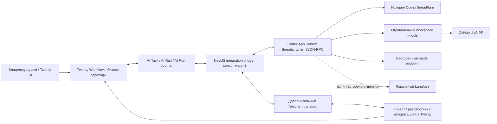

# PRD: AI-оркестратор Twenty + Codex App Server

Язык: русский · Версия: 0.5 · Дата: 1 ноября 2026 · Статус: выбрана архитектура NestJS worker + Codex App Server; runtime не проверен.

[English version](PRD.md) · [Требования](requirements.ru.md) · [Приёмка пилота](requirements/acceptance.ru.md)

## 1. Назначение и основание проекта

Продукт позволяет владельцу задачи поручить инженерную работу выбранному профилю специалиста, наблюдать исполнение в Twenty, разрешать вопросы с клиентом или разработчиком и принимать результат с обязательными проверками и draft PR. NestJS worker управляет Codex App Server через закреплённый JSON-RPC interface. Twenty хранит бизнес-записи, разрешения очереди и решения человека.

[Реестр требований](requirements.ru.md) и связанные контракты — спецификация проекта. Codex App Server выбран целевым runtime; совместимость интеграции и все критерии пилота остаются непроверенными до тестирования с закреплённой версией Codex. Идентификаторы REQ, DATA, STATE, PROTO, OPS и все 28 SAI сохранены.

## 2. Пользователи и результаты

- Владелец задачи / оператор: отправляет работу, наблюдает прогресс, назначает адресатов вопросов, разрешает допустимые действия, запрашивает отмену или доработку и принимает результат в Twenty.
- Сотрудник клиента: входит под личной учётной записью Twenty, видит Kanban-доску и задачи своего клиента и отвечает на адресованные ему бизнес-вопросы. Он не видит записи других клиентов и не подтверждает действия разработчика.
- Разработчик: отвечает на технические вопросы, разрешает или запрещает адресованные действия инструментов в пределах своих полномочий.
- Администратор: настраивает локальный стек, политики проектов/репозиториев, доступ к моделям, идентичности, credentials, резервное копирование и retention.
- Профили специалистов: последовательно выполняют ограниченную работу в одном run. Worker выбирает профиль и управляет handoff; Codex App Server предоставляет threads, turns и поток событий, но не постоянный командный ledger задач.

Адресат вопроса и владелец задачи — разные обязанности. Ответ на вопрос не даёт права принять всю задачу, повторить AI execution, выполнить merge, release или deploy.

## 3. Цели и границы пилота

- Полный путь Project → задача → разрешённый run → работа специалиста → проверки → draft PR → приёмка человеком в локальной Docker-среде.
- Использовать threads, turns и события Codex App Server для исполнения, сохраняя lifecycle продукта и долговечный аудит в Twenty.
- Сократить Twenty Workflows до проверки действий и фактов, разрешения очереди/назначений и применения бизнес-переходов.
- Показывать сотрудникам клиента их задачи в штатной Kanban-доске Twenty и принимать там ответы на адресованные бизнес-вопросы.
- Восстанавливать ожидание и прерванную работу без дублирования вызовов модели, эффектов инструментов, PR и решений человека.
- Сохранить один host, один execution worker, один Twenty workspace, один активный run и последовательных специалистов при `concurrency=1`.

Пилот включает доработку, отмену, бюджет активного времени, восстановление, durable audit и асинхронную аналитику Langfuse. Метрики пилота включают: приёмка с первого run, прохождение проверок, вопросы и попытки, активное время/ожидание, причины доработки и полнота стоимости. Численные цели качества определяются после измерения baseline.

За границами пилота: параллельное исполнение агентов, несколько hosts/workspaces, отдельный клиентский портал, автоматические приёмка, AI retry, merge, release и deploy. Профили специалистов исполняются последовательно в одном разрешённом run. Передача между профилями — политика worker, а не приёмка продукта или переход lifecycle в Twenty.

## 4. Архитектура и владение состоянием



- Twenty владеет `Project`, `AiTask`, `AiRun`, бизнес-статусом, допуском в очередь, версиями разрешений, решениями приёмки и durable-обменом команд/событий в `AiRunJournal`.
- Codex App Server предоставляет threads, turns, items и notifications. Локальная rollout/history state — контекст исполнения, а не бизнес-журнал команд и не гарантия exactly-once.
- NestJS преобразует и проверяет команды/события, обеспечивает границы идентичности и политик, сопоставляет ответы клиентов из авторизованных сессий Twenty и сверяет два хранилища. В нём нет второго движка бизнес-workflow.
- Git/worktree-артефакты и GitHub подтверждают эффекты файлов/PR. Один ответ инструмента не доказывает публикацию при неопределённой доставке.
- Langfuse хранит диагностику и аналитику. Он не заменяет Journal и не разрешает исполнение.

Worker использует поддерживаемые workspace API Twenty с ограниченными credentials, pagination и timeouts. Он не читает и не изменяет PostgreSQL-таблицы Twenty напрямую. История thread и rollout-файлы Codex хранятся и резервируются отдельно от Twenty, но не заменяют `AiRunJournal`.

## 5. Возможности Codex App Server и границы интеграции

| Возможность | Целевое применение | Граница интеграции |
| --- | --- | --- |
| Threads и turns | Создание/возобновление thread, запуск turn и корреляция уведомлений с task/run | Хранить `threadId` и `turnId` в Journal; история thread не является бизнес-состоянием и не доказывает exactly-once |
| Двусторонний JSON-RPC | Worker отправляет запросы и читает ответы/уведомления через stdio или локальный Unix socket | Закрепить версию Codex и generated schema; удалённый WebSocket экспериментален и исключён из пилота |
| Поток событий | Наблюдение за сообщениями агента, прогрессом tools и завершением turn | Преобразовывать только поддержанные события закреплённой версии в Journal facts; потеря уведомления требует reconciliation |
| Approval и interruption | App Server поддерживает approval interactions и `turn/interrupt` | Решения человека остаются в Twenty; approval связывается с точным действием и проверяется по результату runtime |
| Workspace и permissions | Запуск thread с рабочей директорией и sandbox/approval policy | Ограничить workspace и credentials; проверить реальное применение policy на закреплённой host-конфигурации |
| Профили специалистов | Worker выбирает проверенный профиль инструкций/model/policy для последовательного назначения | Предлагаемый worker будет реализовывать и аудировать handoff; постоянный team/task ledger не предполагается |
| Telemetry | Worker может асинхронно экспортировать очищенные facts в Langfuse | Аналитика не блокирует работу и не заменяет Journal; доступность tokens/cost нужно подтвердить |

Worker запускает локальный процесс `codex app-server` и реализует JSON-RPC client. Документированный stdio transport используется по умолчанию; WebSocket listener экспериментален и не поддержан для production, поэтому пилот использует локальный stdio (или локальный Unix socket после отдельной проверки). App Server поддерживает `thread/start`, `thread/resume`, `turn/start`, поток notifications и `turn/interrupt`; эти операции не обеспечивают идемпотентность команд Twenty. Перед каждым вызовом, меняющим исполнение, worker сохраняет intent и выполняет reconciliation после потери ответа. Точное поведение approval и отмены требуется доказать на закреплённой версии Codex.

Повтор по умолчанию не должен воспроизводить неизвестную операцию или превышать бюджет. Codex notifications не заменяют очередь dispatch Twenty. Совместимость model/provider, tools, sandbox и учёта стоимости нужно доказать на закреплённой конфигурации Codex. Review или завершение Codex не заменяют обязательные проверки репозитория и приёмку человеком в Twenty.

## 6. Основной путь пользователя

1. Владелец создаёт задачу в Twenty с Project, описанием, критериями приёмки и ответственными людьми. Project задаёт разрешённый репозиторий, base branch, специалистов, model policy и обязательные проверки.
2. «Отправить» один раз разрешает задачу и ставит её в `READY`. Редактирование или autosave поля не запускает работу.
3. Dispatch проверяет свободное исполнение, политику проекта и полноту ввода, затем сохраняет неизменяемый snapshot, идентичность run и намерение `START`. Уточнение до старта отличается от вопроса в активном run.
4. NestJS worker запускает или возобновляет разрешённый Codex thread, сохраняет его identity, начинает turn и записывает подтверждённые App Server events в Journal. Workflow применяет `RUNNING` только после подтверждения.
5. Worker выполняет выбранный профиль специалиста последовательно в рамках одной task/run/worktree. Handoff — управляемое worker следующее назначение после подтверждённого завершения предыдущего turn и tools; сохраняются task, run, worktree, snapshot и бюджет.
6. Когда Codex запрашивает tool approval или worker выявляет недостающий бизнес-ввод, worker записывает точное действие/вопрос и адресата в Journal; Workflow применяет `WAITING/INPUT` или `WAITING/APPROVAL`. Совместимость должна доказать, как App Server approval-запрос сохраняется и получает ответ через bridge.
7. Клиент или разработчик отвечает в Twenty либо через привязанную Telegram identity. Bridge проверяет адресата, scope, вопрос, назначение и версию действия, записывает один ответ в Journal и использует поддерживаемый approval/continuation path того же thread. Если активный запрос нельзя безопасно продолжить, run остаётся в RECOVERY, новый turn автоматически не запускается.
8. Обязательные проверки выполняются в ограниченном workspace. Успешная попытка требует сохранённых доказательств проверок и draft PR в ожидаемом repository/base/head.
9. Владелец рассматривает отчёт и PR в Twenty. `ACCEPT` переводит задачу в `DONE`; `REWORK` создаёт новую разрешённую инженерную попытку с сохранением предыдущего результата.

Подтверждённый сбой проверки/исполнения требует человеческого решения о retry. Сбой публикации PR повторяет только публикацию после разрешения и reconciliation. Отмена активного run завершается только после доказанной остановки исполнения и tools.

## 7. Вопросы клиенту и разработчику

Логический вопрос содержит текст и безопасный контекст, `questionId`, идентичность task/run при наличии, `requestVersion`, `assignmentVersion`, тип INPUT/APPROVAL, identity/роль адресата, channel и текущее разрешение. Runtime-корреляция использует Codex `threadId`, `turnId` и JSON-RPC request ID, если доступны. Это предлагаемые payload/schema mappings, а не утверждение, что все поля уже существуют в установленном Twenty App.

- Бизнес-неопределённость направляется назначенному клиенту, техническая — назначенному разработчику. Используются проверенные контакты проекта; модель может предложить роль, но не произвольную учётную запись и не новые полномочия.
- Задаётся один actionable-вопрос с форматом ответа либо явными allow/deny. Для tool approval показываются безопасное описание и точные параметры действия.
- Разрешение связывается с рассмотренными действием, параметрами, run, tool call и policy version. Изменённое действие требует нового разрешения; отказ никогда не превращается в согласие.
- Текст вопроса, адресат, ответ/решение, actor, channel и timestamps входят в сохраняемый audit record. Runtime snapshots могут жить меньше этого аудита.
- Если допустимый адресат не настроен, вопрос остаётся видимым в Twenty, владелец уведомляется через поддерживаемый локальный интерфейс. Отсутствие уведомления не разрешает продолжение.
- На клиентский вопрос можно ответить в Twenty или Telegram. Принимается первый сохранённый ответ; повторные, устаревшие и неавторизованные ответы отклоняются без нового resume.


## 8. Доступ клиента в Twenty

Сотрудники клиента входят под личными учётными записями Twenty и используют штатный Kanban/task UI; Telegram — дополнительный канал вопросов и ответов, он не заменяет вход и доску Twenty. У каждого Project один клиент, а учётная запись сотрудника получает назначенный администратором client scope. Права Twenty должны ограничивать этим scope записи и связанные данные; фильтр представления не является границей безопасности.

Сотрудник клиента читает разрешённые поля задач своего клиента и отвечает на адресованный ему вопрос типа INPUT. В Twenty actor берётся из аутентифицированной сессии; для Telegram администратор связывает проверенный numeric Telegram user ID и разрешённый private chat с клиентом. Для разработчика аналогично привязываются индивидуальный Telegram ID и полномочия ответов/allow-deny. Один и тот же client scope, адресат, вопрос и assignment проверяются в обоих каналах; принимается только первый валидный ответ, затем вопрос помечается решённым в другом канале. Проверять отправителя и актуальные права при каждом сообщении/callback, включая старые сообщения; отзыв привязки, чужой адресат или stale assignment блокируют ответ. Клиент отвечает только на адресованный бизнес-INPUT; разработчик может отвечать на технический INPUT и разрешать/отклонять адресованный APPROVAL в рамках своих прав. Клиент не меняет lifecycle, не разрешает запуск, не подтверждает developer tool actions, не принимает/переделывает/отменяет задачи и не читает данные других клиентов. Роль/RLS и поддержка выбранного плана/версии должны пройти SAI-проверки до включения клиентского доступа.

## 9. Journal, восстановление и observability

Сохраняются [модель данных](requirements/domain.ru.md), словарь статусов, `runKey`, `operationKey`, `PENDING`/`APPLIED` и семантика аудита. Codex `threadId`, `turnId` и JSON-RPC request ID отображаются в runtime correlation fields после проверки их семантики на закреплённой schema. Runtime identity не является бизнес-идентификатором.

1. До execution-changing операции сохраняется намерение: start, continuation, assignment, cancellation и publication.
2. Отправляется Codex JSON-RPC request, сохраняется acknowledgement и полученные thread/turn identities. При повторной доставке operation key и payload сравниваются с сохранёнными; возвращается прежний исход.
3. После потери ответа или рестарта процесса проверяются Journal, история Codex thread/turn и внешние артефакты до нового `turn/start`. Если исход установить нельзя, применяется `WAITING/RECOVERY`, очередь остаётся заблокированной.
4. Сохранённый thread возобновляется с исходной identity; ответ человека передаётся только через подтверждённый активный approval/continuation path. Отсутствующее или несогласованное runtime state требует расследования; новый turn не является продолжением прежнего.
5. До освобождения singleton worker подтверждаются остановка и состояние дочерних tools. Активное время сохраняется при restart/handoff, исключается только подтверждённое человеческое ожидание; заданный бюджет ограничивается независимо от связи с Twenty.

Langfuse асинхронно получает traces с корреляцией task/project/run/version. Доступные trace IDs/URLs и delivery checkpoints сохраняются в Twenty. Review/export audit minimum и факты недоставленного экспорта сохраняются по [OPS-07 и OPS-15–OPS-17](requirements/operations.ru.md). Отсутствующие tokens/cost остаются неизвестными. История App Server и Langfuse не заменяют журнал команд.

## 10. Локальная Docker-среда проверки

Все проверки приложения/интеграции выполняются на локальном Docker-стеке с постоянными volumes и закреплёнными версиями компонентов. Целевая настройка Twenty:

```dotenv
IS_MULTIWORKSPACE_ENABLED=false
```

Эффективное значение проверяется в выбранных Twenty server и его background worker с учётом database-backed configuration overrides. Один workspace может содержать несколько клиентов и проектов; флаг не обеспечивает изоляцию записей и не разрешает доступ клиентам.

Планируемые локальные компоненты:

- Стандартный Twenty server, его собственный background worker, PostgreSQL и Redis по требованиям закреплённого Twenty image.
- Один отдельный NestJS worker, запускающий и контролирующий child process Codex App Server; существующий `worker` Twenty не является orchestrator worker.
- Сохраняемые Codex thread/turn rollout data и execution workspace volumes с документированными владельцами, permissions и backup boundary. Отдельная БД для collaboration команды не предполагается.
- Локальный Langfuse и зависимости его выбранной официальной deployment-конфигурации.
- Дополнительный Telegram bot transport для адресованных вопросов/ответов; token хранится только в server-side secret storage.
- Настроенная поддерживаемая Codex model/provider и authentication mode. Поддержку локального endpoint конкретными версиями Codex и моделью нужно проверить; нельзя предполагать, что любой OpenAI-compatible endpoint одинаково поддерживает tools и usage accounting.


Локальные сервисы общаются через Compose network и аутентифицированный Twenty API. SSH forwarding из текущего remote-host контракта для этой среды не требуется; отличие нужно явно согласовать в контрактах. Интерфейсы разработки привязываются к loopback; webhook открывается только при его выборе. Database/admin credentials и неограниченное управление Docker host не передаются agent tools.

Локальный Docker не означает offline: проверки GitHub PR и доставка вопросов в Telegram требуют внешних API и тестовых идентичностей. Интеграцию сначала проверяют на контролируемых fixtures, затем на тестовых аккаунтах. Одни stubs не закрывают end-to-end приёмку. Недоступные credentials, API, model resources и неподдерживаемые packages фиксируются как Not verified.

Текущий [compose.yaml](../compose.yaml) задаёт default `IS_MULTIWORKSPACE_ENABLED=false`. Фактическое значение нужно проверить в локальном runtime: непросмотренный `.env` может его переопределить. Compose пока не разворачивает предлагаемый стек NestJS worker/Codex/Langfuse. Точные images, service names, команды, порты, secrets и migrations относятся к настройке реализации после compatibility checks.

## 11. Проверка и приёмка

Все 28 критериев и их бизнес-результаты сохранены в [контракте приёмки](requirements/acceptance.ru.md); runtime-specific actors и evidence адаптированы для Codex App Server. Каждый критерий остаётся **Not verified** до integration run на закреплённых версиях.

| ID | Фокус проверки локального Twenty + Codex App Server |
| --- | --- |
| SAI-01 | Полная задача, один инженерный run, обязательные проверки, draft PR, приёмка человеком |
| SAI-02 | Повторные authorization/poll/start при рестарте создают одно исполнение |
| SAI-03 | Адресованный ответ продолжает тот же run; явный отказ запрещает действие |
| SAI-04 | Сбой runtime/проверок записан без автоматического AI retry |
| SAI-05 | Доработка создаёт новую request version/run и сохраняет успешную попытку |
| SAI-06 | Отмена подтверждает остановку runtime и tools до CANCELLED |
| SAI-07 | Разрыв Twenty API/локальной сети и рестарт сохраняют исход и блокируют новое исполнение |
| SAI-08 | Потерянный ответ старта и рестарт сервиса сверяют исходное исполнение Codex App Server |
| SAI-09 | Заданный default-бюджет 60 минут сохраняется при restart/handoff; подтверждённое ожидание исключено |
| SAI-10 | Второй execution worker или недоступный/повреждённый Journal блокируют старт |
| SAI-11 | Неверные/устаревшие question, assignment, cancellation или event не меняют другой run |
| SAI-12 | Роли, изоляция клиентов через UI/API, Telegram identity/bot secret и sandbox репозитория/tools |
| SAI-13 | App schema/API, Telegram authorization/deduplication, JSON-RPC invocation, thread/turn events, approval, cancellation и reconciliation закреплённого Codex |
| SAI-14 | Параллельные workflow triggers и применение событий идемпотентны и не создают loops |
| SAI-15 | Только Workflows применяют lifecycle; bridge/agent не разрешают retry |
| SAI-16 | Разрешённые версионированные профили, проверенный routing и ручная приёмка |
| SAI-17 | Twenty Form и Telegram отклоняют повторы/stale/чужие ответы; клиент отвечает только на INPUT, привязанный разработчик разрешает/отклоняет APPROVAL |
| SAI-18 | Уникальные keys и redelivery без изменения payload; нет отдельной бизнес-очереди |
| SAI-19 | Сотрудник клиента видит только собственную Kanban-доску в штатном UI; история оператора остаётся в Twenty |
| SAI-20 | Реальные Twenty quotas/permissions/helpers; ограниченные polling/progress без нового исполнения при quota errors |
| SAI-21 | Отчёт, обновление App и локальный backup/restore сохраняют историю и ожидающее runtime state |
| SAI-22 | Связь локального Langfuse trace/version/review; сбой не блокирует ответы и исполнение |
| SAI-23 | Различие полной/неизвестной стоимости, сохранение попыток и очищенная аналитика |
| SAI-24 | Обязательный Project, разрешённый репозиторий и неизменяемый active snapshot |
| SAI-25 | Выбор специалиста и подтверждение запуска Codex thread/turn на закреплённой версии |
| SAI-26 | Последовательный A → B в одном run/worktree с контекстом/бюджетом и безопасным рестартом |
| SAI-27 | Один подтверждённый draft PR; неопределённая публикация и разрешённый publication-only retry |
| SAI-28 | Путь владельца и клиента: вход, своя Kanban-доска, ответ в Twenty/Telegram, run и PR |

Дополнительные сценарии пилота дополняют эти ID:

- Клиент получает только адресованный бизнес-вопрос, разработчик — адресованный технический вопрос/approval.
- Повторный, устаревший или чужой ответ в Twenty отклоняется; валидный ответ приводит ровно к одному продолжению.
- Попытки доступа к чужим задачам/search и lifecycle-действия из клиентской учётной записи отклоняются.
- Рестарт bridge/runtime в ожидании и до/после записи ответа: восстанавливается точный вопрос и однократное продолжение либо сохраняется RECOVERY при недостатке доказательств.
- Проверить клиентский ввод и изоляцию штатных представлений при недоступности аналитики; сбой telemetry не меняет lifecycle.
- Проверка эффективного `IS_MULTIWORKSPACE_ENABLED=false`, одного workspace, авторизации разных проектов/клиентов и изоляции thread/workspace.

Для каждого runtime-сценария сохраняются pinned versions, эффективная конфигурация без secrets, предусловия, шаги, фактический результат, task/run/operation/question identities и очищенные доказательства. Статические проверки документации и корректный Compose не доказывают runtime-критерии.

## 12. Реализация, изменения контрактов и открытые решения

1. Рассмотреть эту продуктовую модель и согласовать её с [требованиями](requirements.ru.md), [domain](requirements/domain.ru.md), [protocol](requirements/protocol.ru.md), [operations](requirements/operations.ru.md) и [acceptance](requirements/acceptance.ru.md) в RU/EN. Сохранить идентификаторы и семантику аудита. Явно пересмотреть REQ-06–REQ-16, REQ-23–REQ-32, PROTO-06/PROTO-07 и затронутые runtime/transport references; не заменять tokens глобально.
2. Закрепить версии Twenty/App SDK и Codex CLI/App Server; сгенерировать и сохранить protocol schema. В compatibility spike доказать mapping thread/turn, последовательные профили, изоляцию workspace, отсутствие auto-replay и поведение restart/approval.
3. Определить дополнения Compose, persistence Codex rollout/workspace, `IS_MULTIWORKSPACE_ENABLED=false`, границы secrets, singleton ownership и mapping App Server events → Journal.
4. Реализовать минимальный сквозной путь: Twenty START → Codex App Server → подтверждённый результат → проверки/draft PR → Twenty review. Вопросы/resume клиента добавить в тот же путь авторизации.
5. Проверить сбои, бюджет, отмену, повторную доставку, backup/restore и все сохранённые SAI. Записать доказательства и оставшиеся блокеры; только реальные интеграционные результаты меняют verification status.

Открытые решения, требующие доказательств или рассмотрения владельцем:

- Возможность безопасно сохранять и отвечать на App Server approval requests через Twenty после рестарта worker; завершённый или прерванный turn нельзя считать возобновляемым без доказательства.
- Routing/profile selection и handoff принадлежат worker; Twenty проверяет Project policy и владеет разрешением run. Сохранить pre-start/no-run и assignment guarantees.
- Schema mapping идентификаторов Codex App Server и миграция существующей активной работы; старое исполнение должно завершиться или быть доказанно остановлено до смены runtime.
- Назначение client membership, адресаты вопросов, точная поддержка row-level permissions в Twenty и retention.
- Поддерживаемые Codex model/provider и authentication mode, изоляция tools, обязательные проверки репозитория и backup/restore Twenty вместе с Codex thread/workspace state.
- Конфигурация закреплённых сервисов и приоритет эффективной настройки Twenty. Поддержка env variable в исходниках не доказывает её runtime-значение в выбранном image.

Существующие доказательства приёмки не переносятся в этот вариант автоматически. Этот PRD — документ для рассмотрения; реализация, локальная интеграция и готовность production остаются Not verified.

## 13. Документация runtime

Использовать официальную [документацию Codex App Server](https://developers.openai.com/codex/app-server) для протокола, transport, lifecycle thread/turn, событий, approval и генерации схемы для конкретной версии. [Codex SDK](https://developers.openai.com/codex/sdk) приведён только для сравнения сценариев автоматизации; здесь выбран App Server из-за потоковых событий и approval-взаимодействий. Закреплять версии и проверять все нужные возможности в локальной интеграции.
